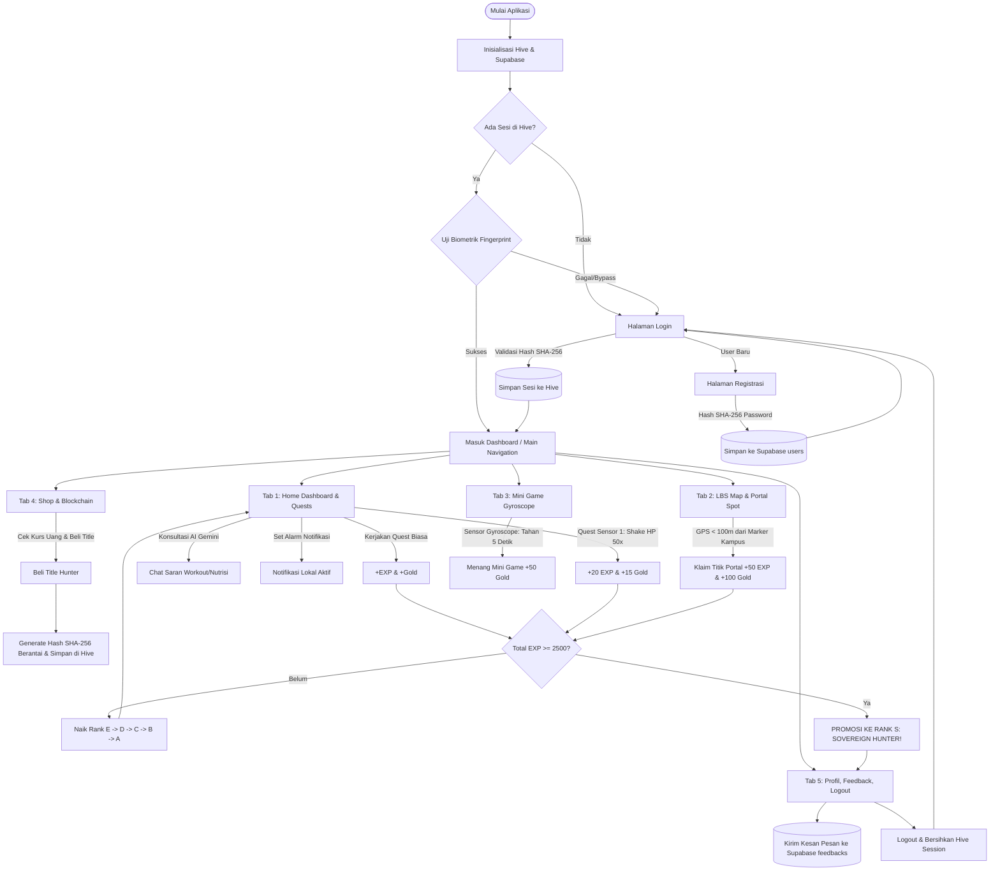

# Alur Aplikasi End-to-End (User Journey) - LevMax

Dokumen ini mendeskripsikan skenario dan alur teknis lengkap perjalanan seorang pengguna (Hunter) di dalam aplikasi **LevMax**, mulai dari registrasi akun baru, menyelesaikan berbagai jenis quest (termasuk interaksi sensor fisik & LBS), berkonsultasi dengan AI, bertransaksi di blockchain, hingga mencapai kasta tertinggi **Rank S** dan mengirimkan kesan pesan mata kuliah.

---

## 1. Diagram Alur Keseluruhan (End-to-End Flowchart)



---

## 2. Rincian Langkah Demi Langkah (Step-by-Step Walkthrough)

### FASE 1: Onboarding, Registrasi, dan Keamanan Autentikasi
1. **Peluncuran Aplikasi (`main.dart`):**
   * Aplikasi membuka *binding* native, menginisialisasi **Hive** (`sessionBox` & `blockchainBox`), dan menghubungkan client **Supabase**.
   * Pengecekan sesi lokal di Hive:
     * Jika *belum ada sesi*, arahkan ke `LoginScreen`.
     * Jika *ada sesi tersimpan*, opsi login biometrik (`local_auth`) otomatis ditawarkan.
2. **Pendaftaran Hunter Baru (`register_screen.dart`):**
   * Pengguna menginputkan `username` dan `password`.
   * **Enkripsi Sisi Client:** Password langsung di-hash menggunakan algoritma SHA-256 via [hash_service.dart](file:///e:/SEMESTER%205/Mobile/dokumen%20levmax%20v2/struktur_folder_arsitektur_levmax.md#L41).
   * Data dikirim ke tabel `users` di Supabase dengan nilai awal: `exp: 0`, `gold: 0`, `rank: 'F'`, dan `hp: 3`.
3. **Login Pertama Kali (`login_screen.dart`):**
   * Pengguna memasukkan username & password.
   * Client meng-hash password dan memvalidasikannya ke Supabase.
   * Jika cocok, Hive `sessionBox` menyimpan:
     ```dart
     sessionBox.put('isLoggedIn', true);
     sessionBox.put('userId', user.id);
     sessionBox.put('username', user.username);
     ```
   * Pengguna diarahkan ke `MainNavigation`.
4. **Login Biometrik di Kunjungan Berikutnya:**
   * Di layar login tersedia tombol **Fingerprint**.
   * Menekan tombol akan memicu autentikasi biometrik bawaan HP (`local_auth`). Jika sidik jari valid dan sesi tersimpan, pengguna langsung masuk ke dashboard tanpa mengetik ulang password.

---

### FASE 2: Eksplorasi Dashboard & Fitur Penunjang (Tab 1 - Home)
1. **Visualisasi Status Hunter:**
   * Menampilkan avatar, nama hunter, Rank saat ini (**Rank F**, 0 EXP), Progress Bar EXP, Gold (0), serta indikator **3 HP** (Health Points).
2. **Inspeksi Waktu Server (Konversi Waktu):**
   * Terdapat banner dinamis yang mengonversi waktu lokal secara serentak ke 4 zona waktu:
     * **WIB (UTC+7)**
     * **WITA (UTC+8)**
     * **WIT (UTC+9)**
     * **London (GMT / UTC+0)**
   * Banner ini menginformasikan sisa waktu sebelum quest harian di-reset pada pukul 00:00.
3. **Mengaktifkan Pengingat Notifikasi Mobile:**
   * Pengguna menekan tombol FAB Lonceng Notifikasi di kiri bawah.
   * `flutter_local_notifications` menjadwalkan notifikasi lokal: *"Hunter! Selesaikan minimal 3 quest harian agar HP tidak berkurang dan rank tidak diturunkan!"*.
4. **Konsultasi Strategi Leveling dengan Hunter AI (Gemini LLM):**
   * Pengguna menekan tombol FAB Chat AI di kanan bawah (`chat_ai_screen.dart`).
   * Pengguna mengirim prompt: *"Bagaimana cara cepat mencapai Rank S dari Rank F?"*.
   * LLM Gemini dengan *System Persona Hunter Guide* memberikan panduan nutrisi, jadwal workout, dan prioritas quest.

---

### FASE 3: Penyelesaian Quest, Pencarian/Filter, dan Sensor 1 (Accelerometer)
1. **Mencari dan Memfilter Quest:**
   * Pengguna menggunakan `TextField` pencarian untuk mengetik keyword latihan (misal: *"Push Up"*).
   * Pengguna memilih `Dropdown` kategori (*Workout*, *Cardio*, *Appearance*, *Study*) untuk menyaring daftar quest.
2. **Menyelesaikan Quest Mandiri (Self-Reported):**
   * **Push Up (20 Reps):** Dicentang -> `setState` menambah +10 EXP & +5 Gold.
   * **Sit Up (20 Reps):** Dicentang -> `setState` menambah +10 EXP & +5 Gold.
   * **Fokus Belajar 30 Menit:** Dicentang -> +15 EXP & +10 Gold.
3. **Menjalankan Quest Sensor Fisik 1: "Cardio Shake" (Accelerometer):**
   * Pengguna memilih quest *"Cardio Shake (Simulasi Lari/Jalan)"*.
   * Membuka modal khusus (`quest_sensor.dart`). Sensor accelerometer membaca guncangan perangkat pada sumbu X, Y, Z.
   * Pengguna mengocok HP hingga angka *shake counter* mencapai **50/50**.
   * Setelah selesai, quest otomatis tertutup dan memberikan reward instan: **+20 EXP & +15 Gold**.
4. **Menyelesaikan Quest Appearance (Multi-Checklist Modal):**
   * Pengguna membuka quest penampilan, lalu mencentang seluruh 5 sub-quest perawatan diri (cuci muka, sunscreen, moisturizer) di Bottom Sheet.
   * Tombol submit aktif -> reward total **+30 EXP & +20 Gold**.
5. **Kenaikan Rank Awal:**
   * Akumulasi EXP mencapai 100 EXP -> Sistem memicu notifikasi `SnackBar`: *"Rank Up! Selamat, Anda naik ke Rank E!"*.

---

### FASE 4: Eksplorasi Dunia Nyata via LBS (Tab 2 - Map)
1. **Membuka Tab LBS (`tab_map.dart`):**
   * Peta berbasis OpenStreetMap (`flutter_map`) muncul secara mulus.
   * GPS perangkat (`geolocator`) mengambil titik koordinat pengguna saat ini.
2. **Menemukan Titik "Dungeon Secret Portal":**
   * Di peta terlihat *Marker* khusus bertema portal dungeon di sekitar area kampus.
3. **Klaim Hadiah Berbasis Lokasi:**
   * Pengguna mendekati lokasi fisik hingga jarak kurang dari 100 meter (dihitung otomatis via `Geolocator.distanceBetween`).
   * Tombol **"Klaim Hadiah Dungeon"** berubah menjadi aktif.
   * Saat ditekan, pengguna menerima bonus besar: **+50 EXP & +100 Gold** (klaim dibatasi 1x seminggu).

---

### FASE 5: Melatih Fokus Mana via Sensor 2 - Gyroscope (Tab 3 - Game)
1. **Membuka Mini Game "Balance the Mana Core" (`tab_game.dart`):**
   * Muncul arena permainan dengan lingkaran bola mana di tengah dan kotak batas kanvas.
2. **Interaksi Sensor Gyroscope:**
   * Sensor membaca sudut kemiringan (pitch & roll) perangkat dengan *throttling* 100ms agar perangkat low-end tidak lag.
   * Pengguna memiringkan HP secara presisi agar bola mana tetap bertahan di dalam zona hijau (tengah).
3. **Memenangkan Mini Game:**
   * Pengguna berhasil mempertahankan bola selama **5 detik berturut-turut**.
   * Layar menampilkan dialog kemenangan *"Mana Core Stabilized!"*.
   * Pengguna mendapatkan reward: **+50 Gold** (hanya bisa diklaim 1x per hari).

---

### FASE 6: Shop, Konversi Mata Uang, dan Transaksi Blockchain (Tab 4 - Shop)
1. **Memeriksa Kurs Mata Uang Dunia Nyata:**
   * Di bagian atas layar Shop terdapat konversi kurs:
     $$\text{100 Gold} = \text{Rp 15.000 (IDR)} \mid \$1.00\text{ (USD)} \mid €0.95\text{ (EUR)}$$
   * Pengguna dapat mencoba kalkulator interaktif untuk menghitung valuasi Gold yang telah dikumpulkan.
2. **Membeli Title Hunter Eksklusif:**
   * Pengguna memiliki cukup Gold dan memilih membeli item prestise: **"Title: Shadow Monarch"** (300 Gold).
3. **Pencatatan Transaksi ke Blockchain Lokal:**
   * Sistem mengambil hash transaksi terakhir dari Hive `blockchainBox`.
   * Sistem membuat string blok baru:
     $$\text{Data} = \text{userId} + \text{"Title: Shadow Monarch"} + \text{timestamp} + \text{previous\_hash}$$
   * Hash baru dihitung dengan `SHA-256` dan disimpan secara permanen di Hive.
4. **Verifikasi Integritas Data (Ledger Explorer):**
   * Pengguna menekan tombol **"Lihat Log Transaksi Blockchain"**.
   * Muncul Bottom Sheet yang menampilkan riwayat hash berantai panjang (bukti bahwa transaksi telah tercatat secara desentralistik di penyimpanan lokal).

---

### FASE 7: Puncak Perjalanan — Kenaikan ke Rank S (The Sovereign)
1. **Grinding Berkelanjutan:**
   * Melalui kombinasi penyelesaian daily quest, quest sensor cardio, klaim LBS mingguan, dan kemenangan harian mini game gyroscope, akumulasi EXP pengguna terus meningkat melintasi batas:
     * **Rank D:** 300 EXP
     * **Rank C:** 600 EXP
     * **Rank B:** 1000 EXP
     * **Rank A:** 1500 EXP
2. **Mencapai Rank S (2500+ EXP):**
   * Saat EXP menyentuh angka $\ge 2500$, aplikasi menampilkan animasi dialog khusus:
     > 🏆 **"AWAKENING: CONGRATULATIONS SOVEREIGN HUNTER!"**
     > *Anda telah mencapai Rank S — Kasta Tertinggi dalam LevMax!*
   * Status Rank dan EXP baru disinkronisasikan ke tabel `users` di remote database Supabase.

---

### FASE 8: Penutupan, Feedback Mata Kuliah & Logout (Tab 5 - Profile)
1. **Meninjau Statistik Akhir:**
   * Pengguna membuka Tab Profile, melihat avatar megah dengan badge **Rank S**, Title *"Shadow Monarch"*, dan total akumulasi Gold.
2. **Mengisi Form Kesan & Pesan Mata Kuliah:**
   * Pada kartu *"Kesan & Pesan Mata Kuliah Pemrograman Aplikasi Mobile"*, pengguna mengetikkan ulasan, evaluasi, serta apresiasi perkuliahan pada form multi-line.
   * Menekan tombol **"Kirim Feedback"**.
   * Data berhasil di-insert ke tabel `feedbacks` Supabase secara real-time.
3. **Logout Aplikasi:**
   * Pengguna menekan tombol **"Logout"**.
   * Sistem menghapus data sesi pada `sessionBox` di Hive.
   * Layar otomatis dialihkan kembali ke `LoginScreen` menggunakan `Navigator.pushAndRemoveUntil`, menandai satu siklus penuh perjalanan aplikasi telah selesai dengan sempurna.
