# Referensi Class Diagram Fungsional - LevMax

Dokumen ini menyajikan **UML Class Diagram berbasis fungsionalitas (Functional & Domain-Driven Class Diagram)** untuk aplikasi **LevMax**. Diagram ini dirancang lebih sederhana, bersih, dan berfokus langsung pada **logika bisnis, fitur utama aplikasi, dan aliran data**, tanpa menyertakan boilerplate internal framework Flutter (seperti `Widget build`, controller text, pemisahan private `State<T>`, atau styling helper).

Spesifikasi ini sangat ideal digunakan untuk **laporan proyek akhir, dokumentasi tugas rekayasa perangkat lunak, maupun presentasi arsitektur**.

---

## 1. Pendekatan Desain Fungsional

Untuk memudahkan pembacaan dan analisis sistem, arsitektur dibagi menjadi 3 pilar utama:

```
┌────────────────────────────────────────────────────────┐
│               1. DOMAIN & DATA ENTITIES                │
│ (UserModel, QuestModel, AlarmModel, AIPersona, Ledger) │
└───────────────────────────▲────────────────────────────┘
                            │ data binding
┌───────────────────────────┴────────────────────────────┐
│              2. FEATURE MODULES / SCREENS              │
│  (Auth, Home Dashboard, Dungeon Map, Mana Gyro Game,   │
│     Web3 Blockchain Shop, Hunter Profile, AI Chat)     │
└───────────────────────────▲────────────────────────────┘
                            │ business operations
┌───────────────────────────┴────────────────────────────┐
│            3. SERVICE & INFRASTRUCTURE GATEWAYS        │
│   (Supabase, Hive, Gemini AI, Ethereum Web3, Sensors)  │
└────────────────────────────────────────────────────────┘
```

1. **Domain & Data Entities (Data Layer):** Struktur data murni yang merepresentasikan data Hunter, quest, alarm, kepribadian AI, dan rekaman transaksi blockchain.
2. **Feature Modules (Business & Controller Layer):** Representasi fungsional dari setiap antarmuka dan interaksi pengguna.
3. **Service Gateways (Integration Layer):** Layanan komputasi backend, kecerdasan buatan, sensor fisik, dan transaksi on-chain.

---

## 2. Diagram Kelas Fungsional (Mermaid Class Diagram)

Berikut adalah diagram kelas ringkas dan fungsional yang siap dirender:

```mermaid
classDiagram
    direction TB

    %% ==========================================
    %% 1. DOMAIN & DATA ENTITIES
    %% ==========================================
    class UserModel {
        +String id
        +String username
        +int exp
        +int gold
        +String rank
        +int hp
        +addExp(int amount)
        +addGold(int amount)
        +deductGold(int amount)
        +calculateRank() String
    }

    class QuestModel {
        +String id
        +String title
        +String category
        +int expReward
        +int goldReward
        +bool isCompleted
        +toggleComplete()
    }

    class AlarmModel {
        +int id
        +int hour
        +int minute
        +bool isEnabled
        +String label
        +toggleStatus()
    }

    class AIPersona {
        +String name
        +String identity
        +String tone
        +String traits
    }

    class TransactionRecord {
        +String titleName
        +String txHash
        +int priceGold
        +String timestamp
        +String status
    }

    class DungeonGateModel {
        +String id
        +String name
        +String locationName
        +double latitude
        +double longitude
        +String rank
        +String gateType
        +String positiveActivity
        +int expReward
        +int goldReward
        +getDailyGate() DungeonGateModel$
    }

    %% ==========================================
    %% 2. FEATURE MODULES / SCREENS
    %% ==========================================
    class AuthModule {
        +loginWithPassword(username, password) Future~bool~
        +loginWithBiometric() Future~bool~
        +loginWithFaceScan(cameraFrame) Future~bool~
        +registerHunter(username, password, avatarFile) Future~bool~
    }

    class HomeScreen {
        +loadDashboardStats()
        +filterQuests(category, keyword)
        +completeDailyQuest(questId)
        +requestHiddenDungeon() Future~void~
        +setAwakeningAlarm(hour, minute)
    }

    class DungeonMapScreen {
        +trackHunterLocation()
        +detectNearbyPortals()
        +verifyProximity(portalCoordinates) bool
        +claimDungeonConquest(portalId)
    }

    class ManaGameScreen {
        +startGyroscopeEngine()
        +calibrateBallPosition(tiltX, tiltY)
        +evaluateStabilityHold(seconds)
        +rewardManaMastery()
    }

    class ShopBlockchainScreen {
        +fetchValuationRates() Future~void~
        +purchaseTitleOnChain(title, privateKey) Future~String~
        +verifyHashOnEtherscan(txHash) Future~bool~
        +resetHunterPurchases()
    }

    class ProfileModule {
        +updateHunterAvatar(imageFile) Future~bool~
        +submitCourseFeedback(rating, message) Future~bool~
        +configureAIPersona(persona)
        +logoutSession()
    }

    class ChatAIModule {
        +sendHunterQuery(message) Future~String~
        +updateActivePersona(persona)
        +clearChatHistory()
    }

    %% ==========================================
    %% 3. SERVICE GATEWAYS
    %% ==========================================
    class SupabaseService {
        +authenticateUser(username, passwordHash) Future~Map~
        +registerUser(username, passwordHash, avatarUrl) Future~Map~
        +syncHunterStats(userId, exp, gold, rank, hp) Future~bool~
        +uploadAvatarS3(imageFile) Future~String~
        +insertFeedback(userId, message) Future~bool~
    }

    class HiveStorageService {
        +saveSession(user)
        +getSession() UserModel
        +recordBlockchainTx(record)
        +getBlockchainTxLedger() List~TransactionRecord~
        +clearPurchasedTitles()
    }

    class GeminiAIService {
        +generateHiddenDungeonQuest(rank, exp) Future~QuestModel~
        +generateChatAdvice(prompt, persona) Future~String~
    }

    class EthereumWeb3Service {
        +executeSepoliaTx(privateKey, recipient, amountWei) Future~String~
        +checkOnlineTxReceipt(txHash) Future~bool~
        +getRealtimeExchangeRate() Future~Map~
    }

    class BiometricAuthService {
        +verifyFingerprint() Future~bool~
        +enrollFaceTemplate(image) FaceTemplate
        +compareFace(image, template) bool
    }

    class DeviceSensorService {
        +streamGyroscopeEvents() Stream
        +streamAccelerometerEvents() Stream
        +getCurrentGpsCoordinates() Future~Position~
    }

    %% ==========================================
    %% RELASI & INTERAKSI
    %% ==========================================
    %% UI to Entities
    HomeScreen o-- UserModel : binds stats
    HomeScreen o-- QuestModel : manages list
    HomeScreen o-- AlarmModel : configures
    ShopBlockchainScreen o-- TransactionRecord : records
    ProfileModule o-- UserModel : displays profile
    ChatAIModule o-- AIPersona : applies persona
    DungeonMapScreen o-- DungeonGateModel : tracks active daily gate

    %% UI to Services
    AuthModule ..> SupabaseService : verifies credentials
    AuthModule ..> HiveStorageService : caches session
    AuthModule ..> BiometricAuthService : scans face & fingerprint

    HomeScreen ..> SupabaseService : updates exp & gold
    HomeScreen ..> HiveStorageService : reads active session
    HomeScreen ..> GeminiAIService : generates hidden dungeon

    DungeonMapScreen ..> DeviceSensorService : reads GPS
    DungeonMapScreen ..> SupabaseService : grants dungeon rewards

    ManaGameScreen ..> DeviceSensorService : reads Gyroscope
    ManaGameScreen ..> SupabaseService : grants mana exp

    ShopBlockchainScreen ..> EthereumWeb3Service : signs & broadcasts on-chain
    ShopBlockchainScreen ..> SupabaseService : synchronizes gold
    ShopBlockchainScreen ..> HiveStorageService : persists transaction ledger

    ProfileModule ..> SupabaseService : updates avatar & feedback
    ProfileModule ..> HiveStorageService : clears session

    ChatAIModule ..> GeminiAIService : queries LLM
```



---

## 3. Rincian Komponen Berdasarkan Fungsionalitas

### 3.1 Domain & Data Entities
* **`UserModel`**: Menyimpan profil Hunter (ID, Username, EXP, Gold, Rank F–S, dan HP). Memiliki logika mutasi stats (`addExp`, `deductGold`, dan penentuan kalkulasi kenaikan Rank).
* **`QuestModel`**: Menyimpan data misi harian (Workout, Cardio, Appearance, Study) beserta reward EXP dan Gold.
* **`AlarmModel`**: Konfigurasi sirene latihan harian (jam, menit, status aktif/non-aktif, label).
* **`AIPersona`**: Konfigurasi persona kecerdasan buatan (nama, peran, nada bicara, sifat).
* **`TransactionRecord`**: Struktur buku besar (*ledger*) transaksi pembelian title on-chain (nama title, hash transaksi Sepolia, harga gold, timestamp, status).

---

### 3.2 Modul Fitur Pengguna (Feature Controllers)
* **`AuthModule`**:
  * Menangani otentikasi multi-faktor: Password SHA-256, Biometrik Sidik Jari (`local_auth`), dan Pindai Wajah (*Face Recognition*).
  * Menangani pendaftaran akun baru lengkap dengan upload avatar profil.
* **`HomeScreen`**:
  * Dashboard utama: memantau stats bar (HP, EXP, Gold, Rank).
  * Filter quest berdasarkan kategori (Workout, Cardio, Appearance, Study).
  * Penyelesaian quest harian dan pemicu **"Scan Hidden Dungeon"** (membuat misi rahasia via AI).
* **`DungeonMapScreen`**:
  * Menampilkan peta interaktif (OpenStreetMap) dengan marker portal dungeon di area kampus.
  * Membaca GPS perangkat dan memvalidasi apakah pemain berada dalam radius $\le 100\text{ m}$ untuk menaklukkan dungeon.
* **`ManaGameScreen`**:
  * Mini-game konsentrasi mana menggunakan sensor Gyroscope fisik ponsel.
  * Pemain harus menahan bola stabil di zona target selama 5 detik untuk mendapatkan bonus EXP.
* **`ShopBlockchainScreen`**:
  * Toko Title Hunter on-chain berbasis **Ethereum Sepolia Testnet**.
  * Konversi kurs mata uang real-time (USD, IDR, ETH).
  * Menandatangani transaksi dengan Private Key, mencatat hash ke ledger, menyediakan tombol verifikasi langsung ke Etherscan, dan reset inventori.
* **`ProfileModule`**:
  * Mengelola avatar, konfigurasi persona AI asisten, pengiriman kesan & pesan mata kuliah ke server Supabase, serta logout.
* **`ChatAIModule`**:
  * Asisten interaktif Gemini AI yang memberikan saran leveling, tips kebugaran, dan motivasi sesuai kepribadian yang dipilih.

---

### 3.3 Layanan & Gateway Infrastruktur (Service Gateways)
* **`SupabaseService`**: Gateway remote database PostgreSQL untuk autentikasi user, sinkronisasi stats EXP/Gold/Rank, upload avatar via S3 SigV4, dan tabel feedback.
* **`HiveStorageService`**: Penyimpanan NoSQL lokal berkecepatan tinggi untuk caching sesi login, kredensial biometrik, state title hunter, dan riwayat hash transaksi blockchain.
* **`GeminiAIService`**: Integrasi Google Generative AI untuk generator narasi Hidden Dungeon dan chatbot interaktif.
* **`EthereumWeb3Service`**: Klien Web3 untuk interaksi RPC Ethereum Sepolia (transaksi on-chain, pengecekan tanda terima hash, dan konversi kurs API).
* **`BiometricAuthService`**: Gateway autentikasi sidik jari OS dan komparasi kemiripan vektor citra wajah (Cosine Similarity & Hamming Distance).
* **`DeviceSensorService`**: Gateway akses sensor fisik smartphone (Gyroscope kemiringan, Accelerometer guncangan kardio, dan GPS Geolocator).

---

## 4. Matriks Pemetaan Fitur ke Alur Kelas (Use Case Flow)

| No | Fitur Pengguna (Use Case) | Komponen UI | Kelas Model | Service / Gateway yang Terlibat |
| :---: | :--- | :--- | :--- | :--- |
| **1** | **Login & Face Recognition** | `AuthModule` | `UserModel` | `SupabaseService`, `HiveStorageService`, `BiometricAuthService` |
| **2** | **Klaim Quest Harian** | `HomeScreen` | `QuestModel`, `UserModel` | `SupabaseService`, `HiveStorageService` |
| **3** | **Generate Hidden Dungeon** | `HomeScreen` | `QuestModel` | `GeminiAIService` |
| **4** | **Konfirmasi Portal GPS** | `DungeonMapScreen` | `UserModel` | `DeviceSensorService`, `SupabaseService` |
| **5** | **Mini-Game Gyroscope** | `ManaGameScreen` | `UserModel` | `DeviceSensorService`, `SupabaseService` |
| **6** | **Beli Title On-Chain Sepolia** | `ShopBlockchainScreen` | `TransactionRecord`, `UserModel` | `EthereumWeb3Service`, `SupabaseService`, `HiveStorageService` |
| **7** | **Cek Transaksi di Etherscan** | `ShopBlockchainScreen` | `TransactionRecord` | `EthereumWeb3Service` |
| **8** | **Konsultasi Chat AI** | `ChatAIModule` | `AIPersona` | `GeminiAIService` |
| **9** | **Kirim Masukan / Feedback** | `ProfileModule` | `UserModel` | `SupabaseService` |

---

## 5. Cara Ekspor & Pemanfaatan

Diagram ini dapat langsung divisualisasikan dengan beberapa cara mudah:
1. **Mermaid Live Editor:** Kunjungi [mermaid.live](https://mermaid.live/), tempelkan kode blok Mermaid dari **Bagian 2**, lalu unduh dalam format gambar **PNG**, **SVG**, atau dokumen **PDF**.
2. **VS Code & Antigravity IDE:** Buka file markdown ini dan aktifkan fitur *Markdown Preview* untuk melihat render grafis diagram secara instan.
3. **Dokumen Laporan / Skripsi:** Anda dapat menyertakan diagram grafis hasil ekspor bersama tabel pemetaan Use Case pada Bab Perancangan Sistem / Desain Arsitektur.
