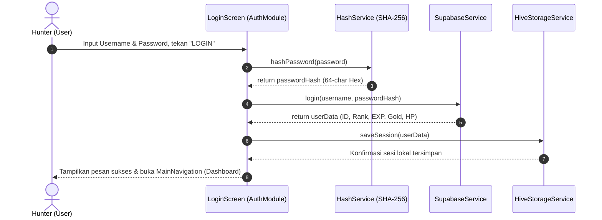
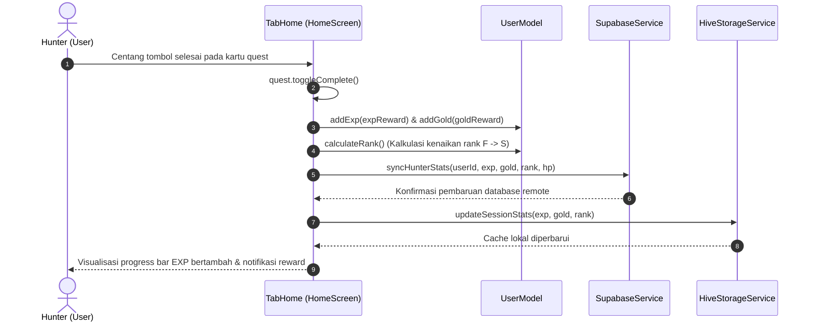
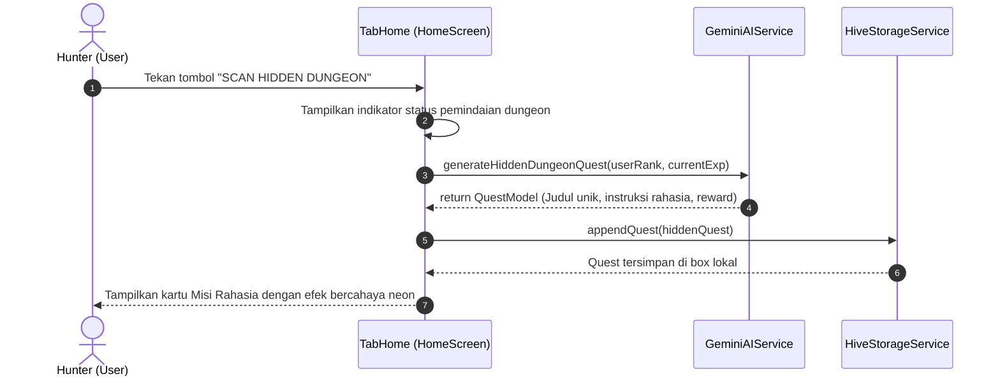
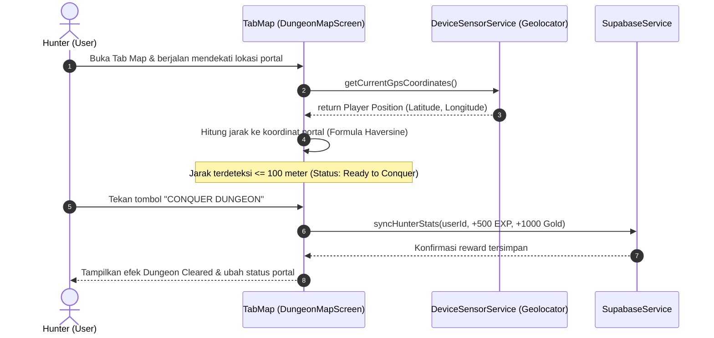
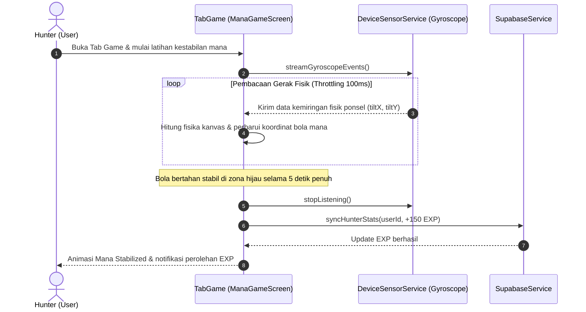
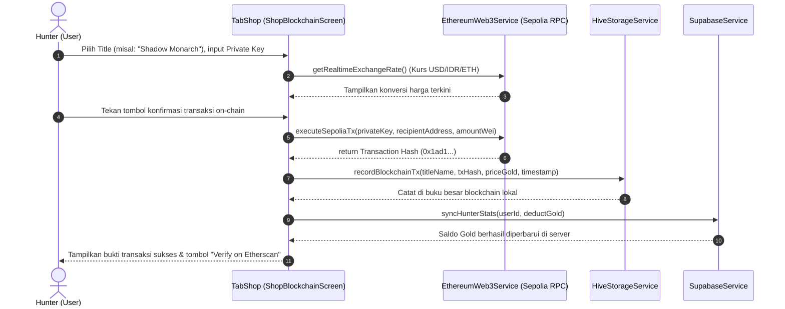
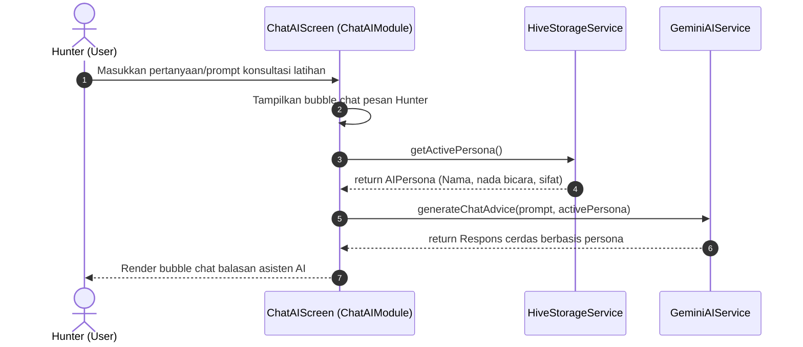

# Referensi Sequence Diagram Fungsional - LevMax (Main Flows)

Dokumen ini menyajikan panduan dan referensi **UML Sequence Diagram** yang dirancang secara **sederhana dan berfokus pada Alur Utama (*Main Flow / Happy Path*)** dari setiap fitur inti aplikasi **LevMax**.

Diagram ini menonjolkan interaksi esensial antara **Aktor (Hunter)**, antarmuka pengguna (**UI / Screen**), pengendali logika bisnis (**Service Gateways**), serta penyimpan data (**Local Hive / Remote Supabase / Blockchain Sepolia / AI Engine**), tanpa membebani pembaca dengan percabangan error-handling yang kompleks. Sangat cocok digunakan untuk **Laporan Proyek Akhir, Bab Perancangan Sistem, maupun Bahan Presentasi**.

---

## 1. Daftar Alur Utama (Main Flows)

Aplikasi LevMax memiliki 7 alur interaksi utama yang memetakan seluruh siklus fitur aplikasi:

1. [**Flow 1: Otentikasi & Login Hunter**](#flow-1-otentikasi--login-hunter)
2. [**Flow 2: Penyelesaian Quest Harian & Leveling**](#flow-2-penyelesaian-quest-harian--leveling)
3. [**Flow 3: Pembuatan Misi Rahasia AI (Scan Hidden Dungeon)**](#flow-3-pembuatan-misi-rahasia-ai-scan-hidden-dungeon)
4. [**Flow 4: Penaklukan Portal Dungeon Kampus (Validasi Radius GPS)**](#flow-4-penaklukan-portal-dungeon-kampus-validasi-radius-gps)
5. [**Flow 5: Latihan Kestabilan Mana (Sensor Gyroscope)**](#flow-5-latihan-kestabilan-mana-sensor-gyroscope)
6. [**Flow 6: Pembelian Title On-Chain di Ethereum Sepolia (Web3)**](#flow-6-pembelian-title-on-chain-di-ethereum-sepolia-web3)
7. [**Flow 7: Konsultasi Interaktif Asisten AI (Gemini Chat)**](#flow-7-konsultasi-interaktif-asisten-ai-gemini-chat)

---

## Flow 1: Otentikasi & Login Hunter

### Deskripsi Alur:
Hunter memasukkan username dan password. Password di-hash menggunakan SHA-256 di sisi klien, lalu dicocokkan ke database remote Supabase. Jika valid, data profil disimpan ke dalam cache lokal Hive untuk manajemen sesi offline/online.

> **Catatan Alternatif (Pindai Wajah / Biometrik):**  
> Hunter juga dapat memilih tombol Pindai Wajah di mana `FaceScanDialog` memproses frame kamera, mencocokkan kemiripan vektor via `FaceRecognitionService` dengan template tersimpan di Hive, lalu langsung mengarahkan user ke Dashboard.

---

## Flow 2: Penyelesaian Quest Harian & Leveling

### Deskripsi Alur:
Hunter menyelesaikan salah satu quest fisik atau disiplin (misal: Workout Push-up). Sistem menandai quest selesai, menambahkan EXP dan Gold, mengevaluasi kenaikan Rank (F s/d S), lalu menyinkronkan data terbaru ke Supabase dan Hive.

---

## Flow 3: Pembuatan Misi Rahasia AI (Scan Hidden Dungeon)

### Deskripsi Alur:
Hunter menekan tombol "SCAN HIDDEN DUNGEON" pada layar utama. Aplikasi mengirimkan profil Rank dan EXP saat ini ke Google Gemini AI untuk mengenerate narasi misi rahasia unik secara dinamis dan menambahkannya ke daftar tugas harian.

---

## Flow 4: Penaklukan Portal Dungeon Kampus (Validasi Radius GPS)

### Deskripsi Alur:
Hunter membuka peta OpenStreetMap, mendekati lokasi portal dungeon fisik di area kampus. Sistem membaca posisi GPS perangkat secara real-time, memverifikasi apakah pemain berada dalam radius $\le 100$ meter, lalu memberikan hadiah EXP dan Gold saat portal ditaklukkan.

---

## Flow 5: Latihan Kestabilan Mana (Sensor Gyroscope)

### Deskripsi Alur:
Hunter melatih fokus dan keseimbangan mana melalui mini-game. Sistem membaca sensor giroskop smartphone untuk mengontrol posisi bola di kanvas. Jika bola berhasil dipertahankan di zona hijau stabil selama 5 detik berturut-turut, sistem memberikan bonus EXP.

---

## Flow 6: Pembelian Title On-Chain di Ethereum Sepolia (Web3)

### Deskripsi Alur:
Hunter membeli Title eksklusif pada Tab Shop. Aplikasi mengambil kurs valas real-time, menandatangani transaksi blockchain menggunakan Private Key milik user, menyiarkannya ke jaringan Ethereum Sepolia, mencatat transaksi ke buku besar (*ledger*) lokal, dan memotong saldo Gold akun.

---

## Flow 7: Konsultasi Interaktif Asisten AI (Gemini Chat)

### Deskripsi Alur:
Hunter mengirimkan pertanyaan seputar latihan, tips pola makan, atau strategi leveling. Modul AI memuat personifikasi asisten yang aktif, meneruskan konteks ke Google Gemini AI, dan menampilkan jawaban secara interaktif.

---

## 2. Rangkuman Komponen & Gateway yang Terlibat

Tabel di bawah merangkum keterlibatan setiap layer pada 7 alur utama:

| Flow # | Nama Alur Utama | Aktor Utama | UI Screen / Modul | Service Utama | Target Data / Eksternal |
| :---: | :--- | :--- | :--- | :--- | :--- |
| **1** | Otentikasi & Login | Hunter | `LoginScreen` | `HashService`, `SupabaseService` | Supabase DB, Hive Local Cache |
| **2** | Quest Harian & Leveling | Hunter | `TabHome` | `SupabaseService` | `UserModel`, Supabase DB, Hive |
| **3** | Scan Hidden Dungeon | Hunter | `TabHome` | `GeminiAIService` | Google Gemini LLM API, Hive |
| **4** | Dungeon Portal GPS | Hunter | `TabMap` | `DeviceSensorService` | GPS Hardware, Supabase DB |
| **5** | Gyroscope Mana Game | Hunter | `TabGame` | `DeviceSensorService` | Gyroscope Hardware, Supabase DB |
| **6** | Web3 Sepolia Shop | Hunter | `TabShop` | `EthereumWeb3Service` | Ethereum Testnet, Etherscan, Hive |
| **7** | Chat AI Assistant | Hunter | `ChatAIScreen` | `GeminiAIService` | Google Gemini LLM API, Hive |

---

## 3. Panduan Ekspor & Visualisasi Diagram

Seluruh sequence diagram di atas menggunakan sintaks standar **Mermaid Sequence Diagram** yang dapat langsung dirender dan diekspor:

1. **Mermaid Live Editor:**
   * Buka [https://mermaid.live/](https://mermaid.live/).
   * Salin blok kode `sequenceDiagram` dari salah satu flow di atas.
   * Unduh dalam format **PNG**, **SVG**, atau salin tautan embed langsung.
2. **VS Code & Antigravity IDE:**
   * Pasang ekstensi *Markdown Preview Mermaid Support*.
   * Buka file ini lalu tekan `Ctrl + Shift + V` untuk melihat visualisasi diagram secara interaktif.
3. **Dokumen Laporan / Skripsi:**
   * Masukkan diagram alur ini pada bab **Perancangan Sistem (System Design)** di sub-bab **Sequence Diagram Sistem**.
