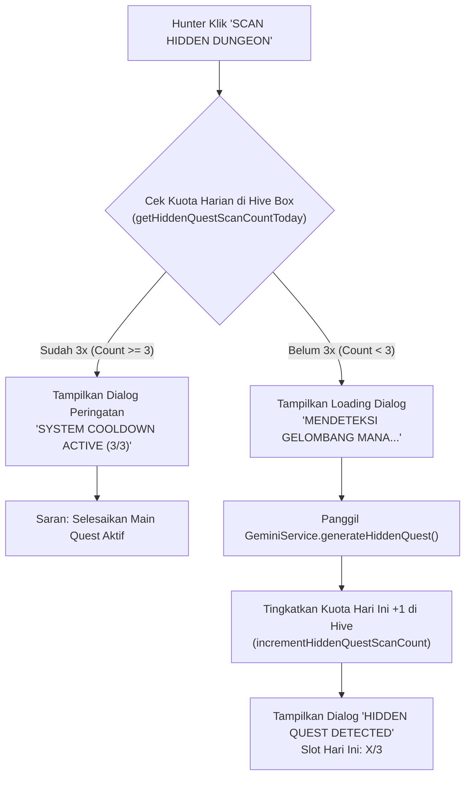

# PANDUAN PRESENTASI FITUR: HIDDEN QUEST LLM & RATE LIMITING
**Dokumen:** `12_Fitur_Hidden_Quest_LLM_dan_Rate_Limiting.md`  
**Fitur Utama:** Dynamic Generative Hidden Quest (Google Gemini AI), Quota Rate Limiting (Maksimal 3x/Hari), dan Self-Improvement Challenge Engine.  
**Kepatuhan Syarat:** Pemenuhan Syarat Tugas Akhir No. 9 (AI-Powered Generation) & FR-4.2 (Skenario Darurat & Gamifikasi Dinamis).

---

## 1. DESKRIPSI & LATAR BELAKANG KONSEP
Fitur **Hidden Quest** terinspirasi dari peristiwa *Double Dungeon / Gerbang Rahasia* pada semesta *Solo Leveling*. Sistem mendeteksi fluktuasi Mana tersembunyi di sekitar Hunter dan memunculkan quest rahasia opsional yang digenerate secara dinamis oleh kecerdasan buatan (**Google Gemini Large Language Model**).

### Mengapa Berbeda dari Main Quest?
- **Main Quest:** Berfokus pada rutinitas harian fisik terstruktur (Push-up, Sit-up, Squat, Pull-up, Lari Jarak Jauh GPS, Skincare Grooming, dan Sesi Pomodoro Belajar).
- **Hidden Quest (Opsional):** Berfokus pada **Tantangan Pengembangan Diri (Real-Life Self-Improvement)** yang melatih atribut non-fisik Hunter di kehidupan nyata, seperti:
  1. **Social Charisma / Agility:** Menyapa orang asing/barista ramah, melakukan kontak mata percaya diri, memecah kecanggungan sosial.
  2. **Sanctuary Purification:** Merapikan dan membersihkan kamar/meja kerja selama 15 menit untuk menjernihkan pikiran (*mental decluttering*).
  3. **Mind & Language Expansion:** Belajar/shadowing Bahasa Inggris selama 15 menit untuk memperluas akses wawasan global.
  4. **Dopamine Detox & Mindful Walk:** Berjalan kaki 15 menit di alam terbuka tanpa menyentuh gawai/ponsel guna memulihkan reseptor dopamin otak.
  5. **Discomfort Training (Cold Shower):** Mandi air dingin 60 detik untuk melatih daya tahan mental terhadap rasa tidak nyaman.

Setiap misi dilengkapi dengan **Analisis Sistem & Manfaat Evolusi**, yaitu penjelasan ilmiah berbasis psikologi dan neurobiologi mengenai pentingnya tantangan tersebut bagi perkembangan karakter Hunter.

---

## 2. ARSITEKTUR RATE LIMITING (MAKSIMAL 3 KALI SEHARI)
Untuk menjaga nilai eksklusivitas quest, mencegah kecanduan (*spamming*), dan menjaga efisiensi kuota API, fitur ini memiliki sistem pembatasan harian ketat:



### Mekanisme Reset Otomatis Pukul 00:00 WIB
1. `HiveService` menyimpan dua kunci per pengguna:
   - `${userId}_hidden_quest_scan_date`: Tanggal pemindaian aktif (format `YYYY-MM-DD`).
   - `${userId}_hidden_quest_scan_count`: Jumlah pemindaian yang telah dilakukan pada tanggal tersebut.
2. Jika tanggal hari ini berbeda dengan `storedDate`, fungsi `getHiddenQuestScanCountToday` secara otomatis mengembalikan angka `0`.
3. Pada `tab_home.dart`, timer `_updateClock()` memeriksa pergantian hari setiap detik. Saat jam menunjukkan pukul 00:00 WIB, state kuota harian di layar akan langsung di-refresh kembali ke `0/3`.

---

## 3. IMPLEMENTASI KODE SUMBER LENGKAP

### A. Layanan Penyimpanan Lokal (`lib/services/hive_service.dart`)
```dart
static const int maxHiddenQuestDailyScans = 3;

/// Mengambil jumlah pemindaian Hidden Quest hari ini (maks 3x/hari)
static int getHiddenQuestScanCountToday([String? userId]) {
  final box = sessionBox;
  final uid = (userId != null && userId.isNotEmpty) ? userId : (box.get('userId')?.toString() ?? 'anonymous');
  final today = DateTime.now().toIso8601String().split('T')[0];
  final storedDate = box.get('${uid}_hidden_quest_scan_date')?.toString();
  if (storedDate != today) return 0;
  final count = box.get('${uid}_hidden_quest_scan_count');
  if (count is num) return count.toInt();
  return 0;
}

/// Menambah hitungan pemindaian Hidden Quest hari ini
static Future<int> incrementHiddenQuestScanCount([String? userId]) async {
  final box = sessionBox;
  final uid = (userId != null && userId.isNotEmpty) ? userId : (box.get('userId')?.toString() ?? 'anonymous');
  final today = DateTime.now().toIso8601String().split('T')[0];
  final storedDate = box.get('${uid}_hidden_quest_scan_date')?.toString();
  int current = 0;
  if (storedDate == today) {
    final val = box.get('${uid}_hidden_quest_scan_count');
    if (val is num) current = val.toInt();
  }
  final next = current + 1;
  await box.put('${uid}_hidden_quest_scan_date', today);
  await box.put('${uid}_hidden_quest_scan_count', next);
  return next;
}
```

### B. Prompt Engineering & Fallback (`lib/services/gemini_service.dart`)
Prompt AI dirancang dengan *guardrails* ketat:
- **Dilarang:** Memberikan latihan fisik rutin (karena repetitif dengan Main Quest).
- **Wajib:** Format Markdown terstandarisasi dengan 3 bagian utama:
  1. `[HIDDEN OPTIONAL QUEST: JUDUL MISI]`
  2. `**Peringatan Sistem:**` (Narasi dramatis Solo Leveling)
  3. `**Instruksi Tantangan:**` (Aksi nyata terukur di kehidupan sehari-hari)
  4. `**Analisis Sistem & Manfaat Evolusi:**` (Penjelasan psikologis/ilmiah mengapa hal ini bermanfaat bagi Hunter)

#### Sistem Multi-Tier Fallback Jika Offline:
Jika jaringan internet terputus atau kuota API Google Gemini habis, `GeminiService` tidak akan mengalami *crash*, melainkan mengeksekusi fungsi `_getRandomOfflineSelfImprovementQuest()` yang memilih salah satu dari 5 kurasi misi pengembangan diri berkualitas tinggi secara acak.

---

## 4. TAMPILAN ANTARMUKA PENGGUNA (UI / HUD)

1. **Tombol Scan Radar (`tab_home.dart`):**
   - Dilengkapi badge status: `OPTIONAL` dan kuota interaktif `[X/3 HARI INI]`.
   - Warna badge berganti dari Neon Cyan (`0xFF00F4FE`) saat kuota tersedia, menjadi Crimson Red (`0xFFFF2A6D`) saat kuota habis.
2. **Dialog Peringatan Cooldown (`_showHiddenQuestQuotaExceededDialog`):**
   - Muncul saat pengguna mencoba memindai lebih dari 3 kali.
   - Bertema Solo Leveling Abyss Card dengan ikon gembok waktu (`Icons.lock_clock_rounded`).
   - Memberitahukan bahwa sistem sedang dalam fase pemulihan Mana hingga pukul 00:00 WIB.
3. **Dialog Hasil Misi (`_showHiddenQuestResultDialog`):**
   - Merender teks hasil generate AI menggunakan `MarkdownBody` dengan `MarkdownStyleSheet` khusus.
   - Judul H3 dirender dengan font *Orbitron* pink menyala (`0xFFFF2A6D`), kata kunci tebal dengan Neon Cyan (`0xFF00F4FE`), dan istilah latihan berformat miring dengan Lilac Purple (`0xFFE5B5FF`).

---

## 5. POIN JAWABAN UNTUK PENGUJI SAAT PRESENTASI (UAS FAQ)

> **Penguji:** *"Mengapa fitur AI Hidden Quest ini dibatasi hanya 3 kali sehari?"*  
> **Jawaban:** *"Ada tiga pertimbangan arsitektural utama:*  
> *1. **Gamifikasi & Makna Quest:** Dalam Solo Leveling, Hidden Quest adalah sesuatu yang langka dan berharga. Jika bisa ditekan tanpa batas, pengguna akan melakukan spam dan nilai kejutan quest hilang.*  
> *2. **Psikologi Pengguna (Anti-Overwhelm):** Quest yang digenerate adalah tantangan nyata di dunia nyata (seperti merapikan kamar, belajar bahasa Inggris, ngobrol santai). Memberikan 1-3 tantangan per hari adalah jumlah yang realistis untuk diselesaikan tanpa membebani mental pengguna.*  
> *3. **Efisiensi Sumber Daya API:** Menghindari pemborosan kuota API LLM dan menjaga aplikasi tetap responsif."*

> **Penguji:** *"Bagaimana jika saat presentasi koneksi internet tiba-tiba mati?"*  
> **Jawaban:** *"Aplikasi kami memiliki sistem **Triple-Tier Fallback**. Jika model utama Gemini 3.5 Flash Lite gagal karena koneksi, sistem otomatis mencoba model kedua. Jika keduanya tidak bisa dihubungi, aplikasi langsung mengambil data kurasi lokal `_getRandomOfflineSelfImprovementQuest()` dari memori sehingga dialog misi tetap muncul mulus tanpa loading macet atau error."*

> **Penguji:** *"Bagaimana sistem memastikan jam reset kuota tidak bisa dimanipulasi dengan mudah?"*  
> **Jawaban:** *"Pengecekan kuota diikat langsung ke kunci tanggal ISO-8601 (`YYYY-MM-DD`). Selain itu, aplikasi memiliki sinkronisasi jam multi-zona (WIB, WITA, WIT, GMT) yang berdetik secara real-time dan mengecek pergantian hari secara otomatis di background."*

