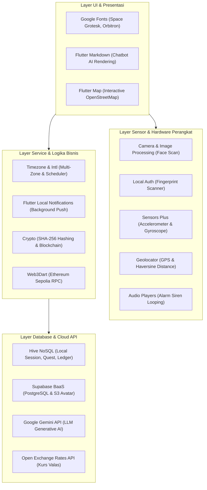

# 13. Daftar Library, API, dan Arsitektur Teknologi Proyek LevMax

**Dokumen:** `13_Daftar_Library_API_dan_Teknologi_Proyek.md`  
**Tujuan:** Panduan komprehensif bagi presenter/mahasiswa saat menjelaskan seluruh pustaka (*library/package*), antarmuka pemrograman aplikasi (*API*), layanan pihak ketiga (*third-party services*), dan algoritma yang digunakan dalam pengembangan aplikasi **LevMax (*The Hunter Awakening System*)**.

---

## 1. Ringkasan Ekosistem Teknologi Aplikasi

Aplikasi LevMax dibangun menggunakan kerangka kerja **Flutter 3.x (Dart SDK ^3.13.2)** dengan mengadopsi prinsip **Offline-First**, **Hardware-Driven Interaction**, dan **Dual Database Architecture (Local NoSQL & Remote Cloud BaaS)**.

---

## 2. Rincian Library, API, dan Dependensi Berdasarkan Kategori

### A. Artificial Intelligence & Large Language Model (LLM)

| Komponen | Spesifikasi / Library | Keterangan & Peran Teknis |
|:---|:---|:---|
| **Package Resmi** | `google_generative_ai: ^0.4.7` | SDK resmi Google untuk memanggil Google Gemini Generative AI secara native di Flutter/Dart. |
| **Model LLM Utama** | `gemini-2.5-flash` | Model berkecepatan tinggi dengan latensi sangat rendah untuk percakapan interaktif asisten Hunter Guide. |
| **Model LLM Fallback**| `gemini-1.5-flash` | Otomatis diaktifkan jika model utama mencapai kuota token atau sedang mengalami antrean padat di server Google. |
| **Endpoint API** | `https://generativelanguage.googleapis.com` | REST/gRPC API dari Google AI Studio. |
| **Renderer Markdown** | `flutter_markdown: ^0.7.7+1` | Mengubah respons teks mentah Gemini yang berformat markdown (tabel, bold, bullet points, code block) menjadi tampilan visual yang rapi di layar chat. |
| **Fitur di Aplikasi** | • **System Guide AI:** Chatbot kebugaran dengan kepribadian dinamis (Beru, Igris, Kaisel, Bellion, Ashborn) menggunakan Prompt Engineering. • **Hidden Quest LLM:** Pembuat misi rahasia adaptif bertema *Self-Improvement* (komunikasi, kebersihan, bahasa asing) dengan sistem batas kuota 3x/hari. |

---

### B. Cloud Backend & Remote Storage (BaaS)

| Komponen | Spesifikasi / Library | Keterangan & Peran Teknis |
|:---|:---|:---|
| **Package BaaS** | `supabase_flutter: ^2.18.3` | Client library untuk terhubung ke Supabase Backend-as-a-Service (PostgreSQL Engine & Cloud Storage). |
| **Arsitektur Auth** | **Non-Firebase Authentication** | Autentikasi kustom mandiri: password pengguna di-hash dengan SHA-256 di sisi klien sebelum divalidasi ke tabel `users` di Supabase. |
| **Endpoint Cloud** | `https://urpfytwepfgaybbautcf.supabase.co` | Server cloud Supabase tempat data tersimpan secara terpusat. |
| **Tabel Database** | • `users`: Data kredensial, statistik RPG (EXP, Gold, Rank F-S, HP 0-3), dan array title yang dimiliki. • `feedbacks`: Penyimpanan masukan/pesan saran mata kuliah untuk dosen penguji. |
| **Penyimpanan Berkas**| **Supabase S3 Bucket (`avatars`)** | Menyimpan foto avatar profil Hunter di cloud. |
| **Protokol Khusus** | `s3_storage_service.dart` | Implementasi murni protokol **AWS Signature Version 4 (SigV4)** dengan otorisasi HMAC-SHA256 untuk upload biner dan pembuatan *Presigned URL* aman tanpa memerlukan SDK pihak ketiga yang berat. |

---

### C. Database Lokal (Offline-First Storage)

| Komponen | Spesifikasi / Library | Keterangan & Peran Teknis |
|:---|:---|:---|
| **Package NoSQL** | `hive: ^2.2.3` & `hive_flutter: ^1.1.0` | Database *key-value* NoSQL yang sangat cepat, ringan, dan berjalan murni dalam memori internal ponsel (*embedded*). |
| **Keunggulan Teknis** | **Zero-Latency & Offline Resilient** | Membaca dan menulis data tanpa *overhead* query SQL, menjaga aplikasi tetap responsif 60 FPS dan fungsional penuh saat ponsel tanpa koneksi internet. |
| **Struktur Box Hive** | • **`sessionBox`**: Sesi Hunter login, bendera biometrik, preferensi AI Persona, dan pencatat kuota harian (*Daily Hidden Quest Tracker*). • **`blockchainBox`**: Buku besar transaksi lokal (*local ledger*) belanja gelar kehormatan dengan hash SHA-256 berantai. • **`questBox`**: Progres penyelesaian misi harian secara offline beserta *timestamp* reset. |

---

### D. Manajemen Waktu, Zona Waktu, dan Penjadwalan

| Komponen | Spesifikasi / Library | Keterangan & Peran Teknis |
|:---|:---|:---|
| **Package Timezone** | `timezone: ^0.11.2` | Engine manipulasi zona waktu berbasis database IANA Time Zone Database (TZDB). |
| **Inisialisasi Data** | `import 'package:timezone/data/latest.dart' as tz;` | Memuat pustaka lengkap aturan waktu dunia dan *Daylight Saving Time* (DST). |
| **Zona Acuan Utama** | `Asia/Jakarta` (WIB / UTC+7) | Waktu resmi server LevMax untuk penentuan reset harian misi dan alarm. |
| **Format Waktu & Tanggal** | `intl: ^0.20.3` | Melakukan standardisasi penanggalan internasional, jam digital 24 jam, dan penulisan angka rupiah. |
| **Fitur di Aplikasi** | • **Simultan 4 Zona Waktu:** Tampilan jam dunia di header tab Peta (WIB UTC+7, WITA UTC+8, WIT UTC+9, dan GMT/UTC+0 London). • **Midnight Auto-Reset:** Penjadwalan reset otomatis quest harian dan kuota hidden quest tepat pukul 00:00 WIB. |

---

### E. Notifikasi Lokal & Audio System

| Komponen | Spesifikasi / Library | Keterangan & Peran Teknis |
|:---|:---|:---|
| **Package Notifikasi**| `flutter_local_notifications: ^22.3.2` | Menjalankan notifikasi push lokal langsung melalui sistem operasi Android tanpa ketergantungan Google FCM. |
| **Izin Sistem OS** | `POST_NOTIFICATIONS` & `SCHEDULE_EXACT_ALARM` | Mendukung penuh izin keamanan terbaru pada Android 13 (API 33) dan Android 14 (API 34). |
| **Channel Notifikasi**| `levmax_daily_notif` (High Importance) | Dilengkapi lampu LED indikator neon, getar berpola, dan suara Solo Leveling System Alert. |
| **5 Skenario Terjadwal** | 1. **Reset Quest:** Pukul 00:00 WIB. 2. **Alarm Pagi:** Pukul 06:00 WIB. 3. **Pengingat 3-Jam:** Pukul 09:00, 12:00, 15:00, 18:00, 21:00. 4. **Sapaan AI Persona:** Pukul 19:30 malam. 5. **System Maintenance Alert:** Pemberitahuan sistem berkala. |
| **Package Audio** | `audioplayers: ^6.8.1` | Memutar file audio lokal (`assets/audio/alarm_siren.mp3`) secara *looping* dengan penyesuaian volume saat alarm latihan aktif. |

---

### F. Sensor Perangkat Keras (Hardware Sensors)

| Komponen | Spesifikasi / Library | Keterangan & Peran Teknis |
|:---|:---|:---|
| **Package Sensor** | `sensors_plus: ^7.1.1` | Pustaka Flutter Community resmi untuk membaca stream data mentah dari chip accelerometer dan gyroscope perangkat. |
| **Sensor 1: Accelerometer** | `accelerometerEventStream()` | • **Quest Cardio Shake:** Membaca akselerasi gerak 3 sumbu ($X, Y, Z$). • **Formula Magnitudo:** $M = \sqrt{x^2 + y^2 + z^2}$. • **Algoritma Guncangan:** Validasi delta guncangan $\Delta > 15 \text{ m/s}^2$ dengan *debounce* 320ms untuk mencegah manipulasi getaran pasif. |
| **Sensor 2: Gyroscope** | `gyroscopeEventStream()` | • **Mini Game Mana Core:** Membaca rotasi sudut *Pitch* ($X$) dan *Roll* ($Y$). • **Mekanisme Game:** Pengguna harus menahan bola energi di dalam lingkaran target selama 30 detik menggunakan kemiringan fisik ponsel pada sensitivitas tinggi (22.0x). |

---

### G. Lokasi & Peta Interaktif (Location-Based Service / LBS)

| Komponen | Spesifikasi / Library | Keterangan & Peran Teknis |
|:---|:---|:---|
| **Package Peta Visual**| `flutter_map: ^8.3.2` | Engine peta berbasis rendering Leaflet untuk menampilkan ubin peta interaktif yang ringan dan responsif. |
| **Matematika Koordinat**| `latlong2: ^0.10.1` | Struktur data titik lintang (*Latitude*) dan bujur (*Longitude*) serta kalkulasi spasial. |
| **Package GPS** | `geolocator: ^14.1.2` | Mengambil titik koordinat GPS riil ponsel dengan pengaturan akurasi tinggi (`LocationAccuracy.high`). |
| **Provider Peta** | **OpenStreetMap (OSM) Tiles** | URL: `https://tile.openstreetmap.org/{z}/{x}/{y}.png` dengan tema CartoDB dark cyber. |
| **Algoritma Jarak** | **Haversine Formula** | Menghitung jarak lengkung bumi antara posisi pengguna dengan titik Dungeon Gate secara presisi (`Geolocator.distanceBetween`). |
| **Mekanisme Geofencing**| **Radius Klaim < 200 Meter** | Gate hanya dapat diekspedisi/diklaim hadiahnya jika jarak fisik Hunter berada dalam radius 200 meter dari lokasi nyata di Yogyakarta (UPN Babarsari, Maguwoharjo, Tambakboyo, dll). |

---

### H. Keamanan, Kriptografi & Blockchain

| Komponen | Spesifikasi / Library | Keterangan & Peran Teknis |
|:---|:---|:---|
| **Package Kriptografi**| `crypto: ^3.0.7` | Pustaka standar enkripsi hashing satu arah (SHA-256) dan HMAC. |
| **Enkripsi Sandi** | **SHA-256 Client-Side Hashing** | Password pengguna langsung dienkripsi menjadi 64 karakter heksadesimal sebelum dikirim ke jaringan, menjamin keamanan data terhadap serangan *sniffing* jaringan. |
| **Blockchain Lokal** | **Immutable Cryptographic Ledger** | Buku besar transaksi belanja gelar (*Title*) di Hive; setiap blok menyimpan data title, timestamp, hash blok sebelumnya (`prevHash`), dan hash blok saat ini (`blockHash`) yang saling mengunci. |
| **Package Web3** | `web3dart: ^3.0.3` | Pustaka penghubung ke jaringan desentralisasi Ethereum Virtual Machine (EVM). |
| **Jaringan Blockchain** | **Ethereum Sepolia Testnet** | Terhubung ke RPC publik (`https://ethereum-sepolia-rpc.publicnode.com`, `https://1rpc.io/sepolia`) dan tautan penelusuran transaksi nyata di Etherscan Sepolia. |

---

### I. Biometrik & Computer Vision (Pengenalan Wajah)

| Komponen | Spesifikasi / Library | Keterangan & Peran Teknis |
|:---|:---|:---|
| **Package Biometrik** | `local_auth: ^3.0.2` | Mengakses sensor sidik jari (*fingerprint*) bawaan perangkat Android dengan fallback PIN/pola sistem. |
| **Package Kamera** | `camera: ^0.12.1` | Mengendalikan modul lensa kamera depan ponsel secara *real-time* untuk kebutuhan *Face Scan*. |
| **Package Olah Citra** | `image: ^4.12.0` | Memproses array pixel gambar secara murni di memori (CPU processing). |
| **Pipeline Face Recognition** | `face_recognition_service.dart` | 1. **Cropping:** Memotong frame wajah sesuai lingkaran retikel panduan HUD. 2. **Grayscale:** Konversi citra warna menjadi nilai luminansi 8-bit. 3. **Normalisasi Z-Score:** Menghilangkan bias perbedaan pencahayaan ruangan. 4. **Dual dHash (8x8):** Ekstraksi Difference Hashing horizontal & vertikal. 5. **Dual Matching:** 70% Cosine Similarity (kontur) + 30% Hamming Distance (dHash) dengan ambang batas kelulusan $\ge 70\%$. |

---

### J. Web API & Kurs Valas Finansial (Exchange Shop)

| Komponen | Spesifikasi / Library | Keterangan & Peran Teknis |
|:---|:---|:---|
| **Package HTTP Client**| `http: ^1.6.0` | Melakukan pemanggilan REST API jaringan secara *asynchronous* dengan penanganan timeout & status code. |
| **API Kurs Valuta Asing**| **Open Exchange Rates API** | URL: `https://open.er-api.com/v6/latest/USD` |
| **Fungsi Kurs Live** | **Konversi Real-Time Valas** | Mengambil rasio tukar USD terhadap IDR (Rupiah) dan EUR (Euro) terkini untuk menghitung nilai valuasi aset Gold Hunter dalam mata uang dunia nyata. |
| **Package Launcher** | `url_launcher: ^6.3.3` | Membuka browser eksternal ponsel ke laman Etherscan Sepolia dan faucet token Web3. |

---

### K. Desain Antarmuka, Tipografi & Media

| Komponen | Spesifikasi / Library | Keterangan & Peran Teknis |
|:---|:---|:---|
| **Package Tipografi** | `google_fonts: ^9.0.0` | Memuat font web modern berlisensi terbuka secara dinamis dengan caching lokal. |
| **Tipografi Utama** | • **`Orbitron`**: Font bertema Sci-Fi / Cyber HUD untuk judul besar, rank badge, dan angka timer. • **`Space Grotesk`**: Font monospaced-futuristik untuk kode protokol, metrik sensor, dan label sistem. • **`Plus Jakarta Sans`**: Font modern untuk deskripsi narasi quest, tips tactical, dan dialog teks agar nyaman dibaca. |
| **Manajemen File & Aset**| `image_picker: ^1.1.2`, `file_picker: ^13.2.0`, `path_provider: ^2.1.6` | Memilih foto dari galeri/kamera untuk avatar profil serta mengelola direktori penyimpanan sementara di Android. |

---

## 3. Matriks Referensi Cepat untuk Tanya Jawab Dosen (*Live Defense Cheat Sheet*)

Jika penguji mengajukan pertanyaan spesifik seputar teknologi yang digunakan, gunakan tabel contekan taktis ini:

| Pertanyaan Dosen Penguji | Jawaban Cepat & Tepat Mahasiswa |
|:-------------------------|:--------------------------------|
| *"Aplikasi ini pakai database apa?"* | Menggunakan **Dual Database**: **Hive** (NoSQL Lokal) untuk data offline cepat, dan **Supabase** (PostgreSQL Cloud) untuk sinkronisasi akun & data RPG online. |
| *"Autentikasinya pakai Firebase?"* | **Bukan Firebase**. Kami menggunakan **Supabase BaaS** dipadukan dengan **Client-Side SHA-256 Hashing** (`crypto`) agar kata sandi tidak pernah dikirim dalam bentuk plain text. |
| *"Fitur AI-nya pakai teknologi apa?"* | Menggunakan **Google Gemini API** (`google_generative_ai`) dengan model utama `gemini-2.5-flash` dan fallback `gemini-1.5-flash`, dilengkapi *Prompt Engineering* kepribadian AI dan batas kuota 3x/hari. |
| *"Penjadwalan waktunya mengacu ke mana?"* | Menggunakan pustaka `timezone` dengan database IANA (`timezone/data/latest.dart`) berpatokan pada zona **`Asia/Jakarta` (WIB / UTC+7)** untuk akurasi midnight reset. |
| *"Sensor apa saja yang dipakai?"* | Menggunakan `sensors_plus` untuk **Accelerometer** (deteksi guncangan kardio delta > 15 m/s²) dan **Gyroscope** (deteksi kecepatan sudut pitch & roll mini-game). |
| *"Fitur petanya pakai Google Maps berbayar?"* | Menggunakan kombinasi **`flutter_map`** berbasis **OpenStreetMap (OSM)** gratis dan `geolocator` dengan **Formula Haversine** untuk validasi radius < 200m. |
| *"Face recognition-nya pakai ML Kit atau cloud?"* | Dibuat secara **Algoritmik Mandiri** di sisi perangkat menggunakan pustaka `image` (Grayscale -> Normalisasi Z-Score -> Dual dHash 8x8 -> 70% Cosine Similarity + 30% Hamming Distance). |
| *"Fitur blockchain-nya betulan atau tiruan?"* | Memiliki **2 layer**: Rantai blok lokal (*ledger*) berbasis hash berantai SHA-256 di Hive, dan terintegrasi ke jaringan publik **Ethereum Sepolia Testnet** via pustaka `web3dart`. |
| *"Kurs mata uangnya dari mana?"* | Mengambil data live real-time dari **Open Exchange Rates API** (`open.er-api.com`) menggunakan library `http` untuk konversi Gold ke IDR, USD, dan EUR. |
| *"Bagaimana notifikasi berjalan saat aplikasi ditutup?"* | Menggunakan **`flutter_local_notifications`** yang mendaftarkan jadwal ke *AlarmManager* OS Android menggunakan permission `SCHEDULE_EXACT_ALARM`. |

---
**Dokumen ini siap dijadikan pegangan resmi saat sesi presentasi proyek akhir!**

