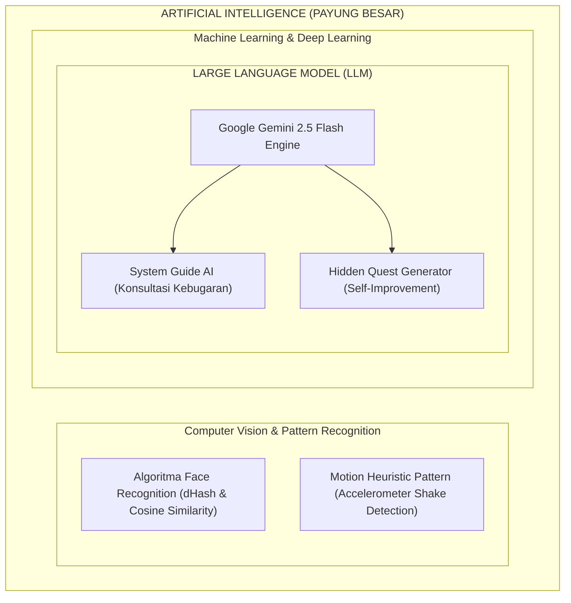
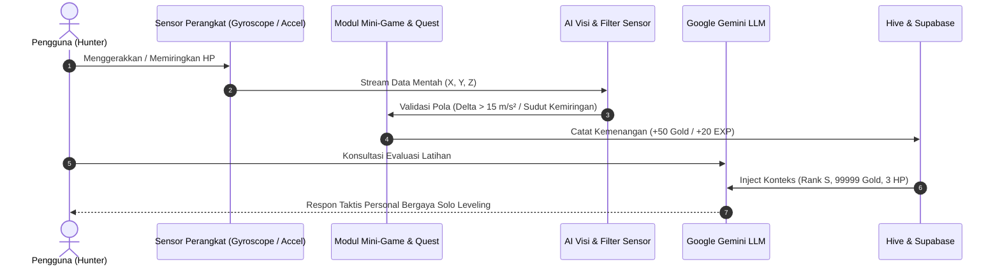

# 14. Panduan Presentasi: Pembedahan Konsep AI vs. LLM, Personifikasi, Sensor, dan Game

**Dokumen:** `14_Penjelasan_Mendalam_AI_vs_LLM_Game_dan_Sensor.md`  
**Tujuan:** Panduan akademis dan taktis untuk menjawab pertanyaan kritis dosen penguji mengenai perbedaan mendasar antara **Artificial Intelligence (AI)** dan **Large Language Model (LLM)**, pemetaan implementasinya di LevMax, letak data personifikasi, status pelatihan data (*training data*), serta peran sensor perangkat keras dan mini game.

---

## 1. Pembedahan Konseptual: Apa Beda AI dan LLM?

Sering kali penguji menguji pemahaman teoritis dengan pertanyaan:  
> *"Mana yang kamu sebut AI dan mana yang kamu sebut LLM? Keduanya kan hal yang berbeda, jangan dicampuradukkan!"*

### A. Definisi & Hubungan Hierarki (Prinsip Payung)
* **Artificial Intelligence (AI):**  
  Merupakan **payung besar (*umbrella term*)** dari ilmu komputer yang mencakup sistem, algoritma, atau mesin apapun yang dapat meniru kemampuan kognitif manusia (seperti mengenali pola, memproses gambar, membaca sensor, memecahkan masalah logika, dan mengambil keputusan).  
  *AI tidak harus berupa teks atau model bahasa besar.* Algoritma pencocokan wajah berbasis matematika, deteksi pola getaran pada sensor, hingga logika *game physics* termasuk dalam rumpun AI.
* **Large Language Model (LLM):**  
  Merupakan **cabang spesifik (*subset*) dari AI**, khususnya di bidang *Deep Learning* dan *Natural Language Processing (NLP)* berbasis arsitektur **Transformer**. Model ini dilatih pada miliaran parameter teks untuk memahami, bernalar, dan menghasilkan bahasa alami manusia secara generatif.



> [!IMPORTANT]
> **Pernyataan Emas untuk Dosen:**  
> *"Semua LLM adalah AI, tetapi tidak semua AI adalah LLM. Di LevMax, kami membedakan secara tegas antara AI Sensor/Visi Komputer dengan AI Generatif Bahasa (LLM)."*

---

## 2. Pemetaan Riil di LevMax: Mana AI (Non-LLM) & Mana LLM?

| Fitur di Aplikasi | Kategori | Teknologi / Algoritma | Alasan Mengapa Bukan/Termasuk LLM |
|:---|:---:|:---|:---|
| **Verifikasi Wajah Biometrik (`Face Scan`)** | **AI (Non-LLM)** | • *Z-Score Luminance Normalization*<br>• *Dual Difference Hashing (dHash 8x8)*<br>• *70% Cosine Similarity + 30% Hamming Distance* | **Bukan LLM.** Ini adalah *Computer Vision & Heuristic Pattern Matching*. Tidak memproses teks bahasa alami, melainkan matriks piksel citra visual. |
| **Deteksi Kardio Accelerometer (`Shake Quest`)** | **AI (Non-LLM)** | • Formula Magnitudo $M = \sqrt{x^2+y^2+z^2}$<br>• Ambang batas dinamis $\Delta > 15 \text{ m/s}^2$<br>• Algoritma *Debounce Window* 320ms | **Bukan LLM.** Ini adalah *Sensor Heuristic Pattern Classifier* untuk membedakan guncangan fisik nyata dari getaran pasif. |
| **Mana Core Stabilization (`Gyroscope Game`)** | **AI / Physics Logic** | • *Angular Velocity Vector ($X, Y$)*<br>• *Real-time Euler Tilt Calculation*<br>• *2D Circular Geofencing Collision* | **Bukan LLM.** Ini adalah kalkulasi dinamika gerak sudut perangkat keras berbasis fisika 2D (vektor kemiringan ponsel). |
| **Hunter Assistant Chatbot (`Chat AI Screen`)** | **LLM** | • Google Gemini API (`gemini-2.5-flash`)<br>• Arsitektur Transformer Generatif<br>• *Multi-turn Conversational Context* | **Murni LLM.** Mampu memahami konteks percakapan bebas pengguna, bernalar tentang kebugaran, dan menyusun kalimat secara dinamis. |
| **Generator Misi Rahasia (`Hidden Quest`)** | **LLM** | • *Generative Prompting System*<br>• *Self-Improvement Challenge Synthesis* | **Murni LLM.** Menghasilkan narasi tantangan personal (interaksi sosial, kebersihan, belajar) secara kreatif tanpa *hardcoded* statis. |

---

## 3. Personifikasi AI: Di Mana Disimpan & Apakah Termasuk LLM?

### A. Di Mana Data Personifikasi Disimpan?
Data personifikasi disimpan secara lokal dan persisten di database **Hive NoSQL (`sessionBox`)**, tepatnya pada *key*:
```dart
'ai_persona_config'
```
Dikelola melalui berkas model [`lib/models/ai_persona_model.dart`](file:///c:/Semester%205/Moblie%20Teori/final_project/levmax_v2/lib/models/ai_persona_model.dart) dan layanan [`lib/services/hive_service.dart`](file:///c:/Semester%205/Moblie%20Teori/final_project/levmax_v2/lib/services/hive_service.dart).

Struktur data JSON yang tersimpan di Hive:
```json
{
  "name": "BERU",
  "role": "PANGLIMA BAYANGAN",
  "tone": "Formal, Dingin & Otoritatif",
  "traits": ["Loyal", "Agresif", "Pelindung"],
  "avatarPath": "assets/images/beru_avatar.png"
}
```

### B. Apakah Personifikasi AI Itu Termasuk LLM?
* **Data konfigurasinya sendiri:** **Bukan LLM**, melainkan *state configuration data* (objek JSON biasa di memori lokal ponsel).
* **Mekanisme kerjanya saat berjalan:** Merupakan penerapan teknik **System Prompt Engineering / Conditioning pada LLM**.

**Bagaimana alurnya di kode ([`lib/services/gemini_service.dart`](file:///c:/Semester%205/Moblie%20Teori/final_project/levmax_v2/lib/services/gemini_service.dart))?**
1. Aplikasi membaca konfigurasi dari Hive: Nama = `Beru`, Gaya = `Dingin & Militan`.
2. `GeminiService` menyusun instruksi sistem (*System Instruction*):
   ```
   "Anda adalah Beru, Panglima Bayangan dari Solo Leveling. 
    Bicaralah kepada Hunter dengan nada formal, dingin, dan loyalitas tinggi. 
    Jangan pernah keluar dari karakter ini."
   ```
3. Teks instruksi ini disuntikkan ke parameter `systemInstruction` pada Google Gemini Model.
4. **Hasilnya:** LLM Gemini mengadaptasi seluruh bobot inferensinya agar merespons persis seperti karakter Beru.

> [!NOTE]
> **Kesimpulan:** Data personifikasi adalah *input pengarah (kondisioner)*, sedangkan yang menjalankan peran personifikasi tersebut di dunia nyata adalah **mesin LLM Gemini**.

---

## 4. Apakah Proyek Ini Melatih (*Train*) Model Sendiri?

Pertanyaan dosen:  
> *"Kalau kamu pakai LLM, apakah kamu melatih datanya sendiri? Di bagian mana file latihannya? Kalau tidak ngetrain, kenapa masih berani kamu sebut LLM?"*

### A. Jawaban Tegas & Jujur
> **"Tidak, kami TIDAK melatih (*pre-train*) model dari nol, melainkan menggunakan Foundation Model Pre-trained (Google Gemini 2.5 Flash) yang diakses melalui API, lalu diarahkan perilakunya menggunakan teknik In-Context Learning & System Prompt Engineering."**

### B. Mengapa Tidak Melatih Model dari Nol?
1. **Kebutuhan Komputasi yang Mustahil untuk Aplikasi Mobile:**  
   Melatih model LLM skala industri dari awal membutuhkan ratusan hingga ribuan unit GPU server (seperti NVIDIA H100) dengan biaya miliaran rupiah dan memakan waktu berbulan-bulan.
2. **Ukuran File Model (*Footprint*):**  
   Model LLM mentah memiliki ukuran puluhan Gigabyte (GB). Ponsel pengguna (misal Oppo A5) tidak akan sanggup menampung maupun mengeksekusi model sebesar itu secara lokal di memori RAM perangkat.
3. **Standar Industri Rekayasa Perangkat Lunak (*Industry Best Practice*):**  
   Di dunia profesional modern, developer aplikasi tidak membuat ulang fondasi dasar bahasa, melainkan memanfaatkan **Foundation Model API** kelas dunia yang sudah matang dari penyedia terpercaya (Google Cloud / OpenAI), lalu mengkhususkan fungsinya (*domain adaptation*) melalui **Prompt Engineering** dan **Context Injection**.

### C. Mengapa Tetap Sah dan Wajib Disebut LLM?
Meskipun tidak melatih model sendiri, fitur ini **mutlak tetap disebut LLM** karena:
1. **Engine Pemrosesnya Adalah Arsitektur Transformer LLM:**  
   Setiap kata yang diketikkan pengguna tidak diproses oleh aturan logika statis (`if-else`), kamus kata kunci, atau *regex bot*, melainkan diproses oleh neural network *deep learning* Gemini berbobot miliaran parameter yang memahami konteks dan semantik bahasa.
2. **Kemampuan Generatif Adaptif:**  
   Jawaban yang diberikan Gemini tidak pernah sama persis; ia mampu berimprovisasi, memahami sinonim, mendeteksi nada bicara pengguna, dan menghasilkan narasi baru yang unik.
3. **In-Context Learning:**  
   Aplikasi kita menyuntikkan konteks dinamis status pengguna (Rank Hunter, sisa HP, perolehan EXP, dan nama personifikasi aktif) ke dalam percakapan secara *real-time*.

---

## 5. Hubungan Sinergis: Sensor, Game, AI, dan Gamifikasi RPG

Bagaimana semua komponen ini saling terhubung di LevMax?



1. **Sensor Perangkat Keras sebagai Jembatan Nyata:**  
   Sensor Accelerometer dan Gyroscope membaca dunia fisik pengguna, memastikan bahwa pengguna benar-benar bergerak dan berolahraga secara nyata.
2. **AI Sensorik sebagai Pengawas Kebenaran (*Integrity Validator*):**  
   Algoritma AI non-LLM memastikan tidak ada kecurangan (misalnya menyaring getaran palsu kendaraan menggunakan batas akselerasi $\Delta > 15 \text{ m/s}^2$ dan jendela *debounce* 320ms).
3. **Mini Game sebagai Media Interaktif Gamifikasi:**  
   Mengubah kalibrasi sensor gyroscope yang membosankan menjadi tantangan "Mana Core Stabilization" 30 detik yang adiktif dengan hadiah ekonomi RPG (+50 Gold).
4. **LLM sebagai Narator & Motivator Cerdas:**  
   Membungkus seluruh data kering angka latihan menjadi narasi epik dunia Hunter Solo Leveling, merespons pertanyaan pengguna secara cerdas, dan memberikan quest pengembangan diri (*Hidden Quest*).

---

## 6. Contekan Jawaban Ujian (*Q&A Defense Sheet*)

Berikut adalah simulasi tanya jawab yang sangat mungkin ditanyakan oleh penguji:

#### Q1: *"Mana yang AI dan mana yang LLM di aplikasi Anda?"*
> **Jawaban:**  
> *"AI pada aplikasi kami terbagi menjadi dua ranah, Pak/Bu:  
> 1. **AI Non-LLM (Computer Vision & Sensorik):** Algoritma pencocokan wajah pada kamera depan menggunakan Z-Score Normalization dan Dual Difference Hashing (dHash) untuk biometrik, serta algoritma klasifikasi pola guncangan pada Accelerometer.  
> 2. **AI Berbasis LLM (Generatif):** Fitur asisten System Guide dan generator misi rahasia (Hidden Quest) yang menggunakan model Google Gemini 2.5 Flash untuk memahami dan merespons bahasa manusia secara alami."*

#### Q2: *"Di mana letak file personifikasi AI-nya dan apa formatnya?"*
> **Jawaban:**  
> *"Tersimpan di database lokal NoSQL **Hive (`sessionBox`)** dengan key `'ai_persona_config'`. Formatnya berupa struktur Map/JSON yang memuat nama, peran, gaya tutur kata, dan daftar sifat kepribadian yang dimodelkan pada file `lib/models/ai_persona_model.dart`."*

#### Q3: *"Apakah personifikasi itu termasuk LLM?"*
> **Jawaban:**  
> *"Data personifikasinya adalah data konfigurasi (*state*), tetapi penerapannya di dalam aplikasi menggunakan teknik **System Instruction Conditioning** yang disuntikkan ke dalam LLM Gemini. Jadi, LLM-lah yang memerankan kepribadian tersebut saat berdialog dengan Hunter."*

#### Q4: *"Apakah Anda melatih (*training*) data LLM-nya sendiri?"*
> **Jawaban:**  
> *"Kami tidak melakukan pre-training model dari nol karena memerlukan sumber daya GPU server berskala data center. Kami mengadopsi standar industri modern, yaitu memanfaatkan **Foundation Model Pre-trained** dari Google (Gemini) melalui API, lalu menerapkan **Prompt Engineering** dan **In-Context Injection** agar respons model berfokus khusus pada tema kebugaran dan semesta Solo Leveling."*

#### Q5: *"Kenapa mini game pakai Gyroscope, bukan tombol sentuh biasa?"*
> **Jawaban:**  
> *"Karena tujuan utama LevMax adalah menghubungkan interaksi fisik nyata ke dalam gamifikasi RPG. Sensor Gyroscope membaca sudut kemiringan fisik ponsel secara presisi pada 60 FPS loop, sehingga melatih konsentrasi motorik halus pengguna untuk menyeimbangkan bola mana, bukan sekadar menekan layar."*

---
**Dokumen ini siap dijadikan pedoman resmi saat berhadapan dengan dosen penguji!**
